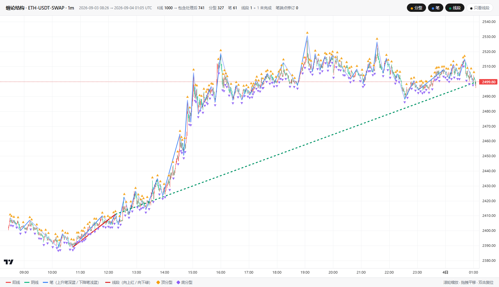
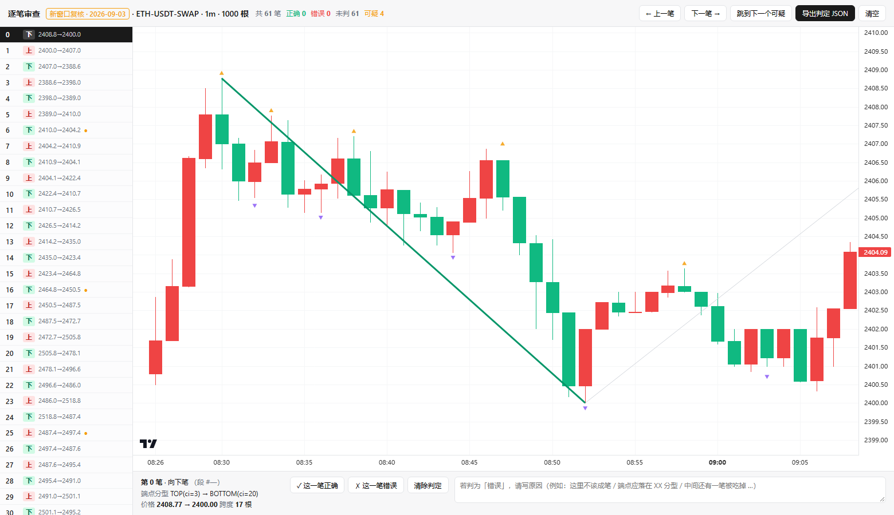

# chanlun-engine · 缠论结构引擎（笔 / 线段）

按《缠论量化-笔与线段-伪代码.md》实现的**因果流式**缠论结构识别引擎，
在 OKX `ETH-USDT-SWAP` 1 分钟 1000 根 K 线上完成回测、可视化，
并**经 4 轮人工逐笔审查收敛**出笔的划分规则。

> 本仓库的笔规则不是「教科书照抄」，而是从用户对 **76 笔的逐笔判定**
> （41 笔 ✅ / 35 笔 ❌ 带理由）中反向提炼、再用**随机换窗口交叉验证**
> 校准出来的。全过程记录见下方「笔的规则演化史」。



---

## 目录

```
chan.py                 引擎（包含处理 / 分型 / 笔 / 线段）★ 核心
test_chan.py            17 项不变式测试
export_review.py        导出逐笔审查数据 out/bi-review-data.json
build_review.py         生成逐笔审查工作台 out/bi-review.html
export_structure.py     导出结构数据 out/structure.json
build_html.py           打包自包含可视化 out/chan-chart.html
fetch_candles.py        从 OKX 拉取随机 1000 根 1m K 线
data/eth_1m_1000.json       当前样本窗口（2026-09-03，单边上涨）
data/eth_1m_1000.prev.json  回归基线窗口（2026-10-01，震荡）
vendor/                 lightweight-charts v4.2.0（本地化，无需联网）
docs/                   截图
```

## 运行

```bash
python test_chan.py          # 17 项不变式，应全部 PASS
python export_structure.py   # 生成 out/structure.json
python build_html.py         # 生成 out/chan-chart.html（双击打开）

# 逐笔人工审查工作台
python export_review.py      # → out/bi-review-data.json
python build_review.py       # → out/bi-review.html
```

`out/` 是构建产物目录，未纳入版本控制。

## 拉取新行情

`fetch_candles.py` 随机取一个历史窗口，经代理调用 OKX CLI：

```bash
python fetch_candles.py --days 45
```

会先用 `node` 直调 `okx-trade-cli`，分 4 批（`--after` 游标）取满 1000 根，
写入 `data/eth_1m_1000.json`，并把旧文件自动备份为 `data/eth_1m_1000.prev.json`。

需要设置代理：
`HTTP_PROXY=HTTPS_PROXY=http://127.0.0.1:7890`（按你的本地代理端口调整）。

---

## 四层结构

| 层 | 类 | 职责 |
|---|---|---|
| 1 | `InclusionProcessor` | K 线包含关系处理，方向跨 K 线持久化 |
| 2 | `FractalEngine` | 三 K 双向严格分型 + `INVALIDATED` 回滚 |
| 3 | **`BiEngine`** | 笔的五阶段预处理划分法（`MIN_BI_CANDLES = 5`） |
| 4 | `SegmentEngine` | 特征序列 + 非包含处理 + 端点极值定位 |

---

## 笔的四条主规则

| 规则 | 内容 |
|---|---|
| **R1 端点必须是区间极值** | 一笔的顶/底分型，必须是该笔区间内的最高/最低点 |
| **R2 独立性约束** | 分型中心距起点 `< MIN_BI_CANDLES - 1`（=4）不能当端点 |
| **R3 同类去弱** | 连续同类型分型只留更极端者 |
| **R4 多笔合一笔** | 中间笔若违反 R1，被两侧笔吞并合并 |

R1 是主规则，R2/R3/R4 都是它的推论。

## 实现：`BiEngine._preprocess` 五阶段

```
① 同类去弱（R3）        连续同类型分型只留极值
② 独立性过滤（R2）      相邻异类间距 < 4 则丢弃后者，记入 dropped
③ 弃点极值补正（R1∘R2） 被丢弃的 f 若比其后最近的同类已接受节点更极端、
                        且间距 ≤ 4，则顶替之
④ 端点右移（R1/R4）     搜索窗上界 = 下一个与 cur 同类型的骨架节点；
                        ★ 只跑一遍（迭代会链式误吞）
⑤ 折叠收敛迭代          同类去弱 + 过近丢弃 + 弃点补正，
                        ★ 带时序保持约束 prev.center < f.center < next.center
```

输出序列**严格交替**，相邻两两配对即成笔。

---

## 实测结果

| 窗口 | 形态 | K 线 | 分型 | **笔** | 最小跨度 | 线段 |
|---|---|---|---|---|---|---|
| `eth_1m_1000.prev.json`（2026-10-01） | 震荡 2672~2718 | 1000 | 317 | **54** | 4 | 8 |
| `eth_1m_1000.json`（2026-09-03） | 单边 2389~2531 | 1000 | 327 | **61** | 4 | 1 |

两个窗口均：**最小跨度 = 4**（无伪笔）、**全程时序连续**、17 项不变式全绿。

### 用户判定命中

对回归基线窗口的用户回执：

```
第 1 轮  41 笔 ✅ 命中 41/41 ｜ 35 笔 ❌ 真残留 0
第 2 轮  指定终点修正 225→240        ✅ 已产出
第 3 轮  #15 起点侧 → 190→201        ✅ 已产出
         三笔合一 → 541→576          ✅ 已产出
零误伤   101→113 (#07) · 143→149 (#11)
```

---

## 笔的规则演化史（每条都来自一次真实的翻车）

| 版本 | 改动 | 笔数 | ok 命中 | 残留 bad |
|---|---|---|---|---|
| v4 | 骨架（同类去弱 + 独立性过滤） | 76 | 41/41 | 35 |
| v5 | + 端点右移（R1/R4） | 56 | 41/41 | 3 |
| v6 | + 弃点极值补正（第二遍半） | 56 | 41/41 | **0** |
| v7 | + 折叠收敛迭代 | 54 | 41/41 | 0 |
| **v8** | **+ 时序保持约束** | **54 / 61** | **41/41** | **0** |

**v5：端点右移只跑一遍。** 迭代会链式误吞——`101→113` 被后续轮次并成
`101→149`，吃掉用户已认可的两笔。

**v6：第二遍「丢弃后不回头看」缺陷。** 第二遍丢弃「过近」分型后不再回头，
会出现「**被丢的更极端、被留的更弱**」，直接违反 R1。典型案例：骨架里
`T576(2701.92)` 因距 `B574` 仅 2 根被丢，而 `T579(2701.60)` 因距 5 根被留
——**丢了更高的顶**。补正容差取 `MIN_BI_CANDLES-1 = 4`，与 R2 同源、
无自由参数（放宽到 6 就会连锁吞笔，ok 掉到 38/41）。

**v7：折叠阶段重犯同一缺陷。** 折叠时 `B560(2696.84)` 因距 `T557` 仅 3 根
被丢，`B571(2697.60)` 因距 14 根被留——**丢了更低的底**，凭空造出一笔伪笔
`557→571`，还把两侧正确的笔切开。修法：折叠阶段改为**收敛迭代 + 弃点补正**。
此处补正**不限距**（同一结构位置的两个分型可能隔十几根），靠收敛性保证终止。

**v8：不限距会「时序穿越」。** v7 只在震荡窗口验证过。随机换到**单边上涨**
窗口后，笔数**塌缩成 4 笔**，最长一笔跨度 392 根——早期的全局最低底
`B125` 一路顶替其后所有同类节点，被搬到 `T256` 之后，78 个候选节点塌缩成 4 个。

修法：补正必须**保持时序**——替入的 `f` 必须仍夹在目标节点的前后邻居之间
（`prev.center < f.center < next.center`），否则放弃替换。

### ★ 两条铁律

1. **多窗口双验证是必须的。** 只在单一窗口调参必然过拟合。
2. **任何「跨节点搬移」类规则都必须带时序/位置合法性校验。**

---

## 逐笔人工审查工作台



`out/bi-review.html` 是一个自包含单文件页面：

- 左侧 K 线图按序号标出每一笔，右侧逐笔列出 **起点 / 终点 / 方向 / 价格 / 跨度**
- 每笔可判 ✅ 正确 / ❌ 错误，错误可填理由
- 判定结果存 localStorage，可一键**导出 JSON 回执**
- 自动标黄「可疑笔」（跨度偏小/端点非区间极值），供优先复查

**这是本项目规则收敛的核心工具**：人负责判断对错，机器负责从回执里反推规则。
每轮改动换徽章版本号 + 升 localStorage key，避免上轮判定与新编号串味。

---

## 17 项不变式

包含处理 4 项 · 分型 4 项 · **笔 5 项** · 线段 8 项，全部 PASS：

```
包含  方向持久化 / 非空 / source_raw_ids 完备 / 覆盖全部原始序号
分型  索引在 [1,len-2] / top>bottom / 确认位置=中心+1 / 顶底均衡
笔    方向严格交替 / 跨度≥5 / 首尾相接 / 价格序 / 索引与分型一致
线段  方向与价格路径一致 / 首尾严格相接 / 方向交替 / 每段≥3笔
      终点=末同向笔终点且为段内极值 / 方向=起始笔方向
      链索引相接 / 链价格连续 / 终点价位于段区间内
```

`python test_chan.py` 一键验证。

---

## 工程要点（踩过的坑）

- **`Bi` 用扁平字段** `start_center_index` / `end_center_index`，没有 `.start`/`.end`。
- **`build_structure` 必须先跑完所有分型再驱动 `SegmentEngine`**，
  否则端点右移的回溯吞笔会在段引擎里留下 zombie bis。
- **人工分型（`is_artificial=True`）不可过滤** —— 用户认可的端点里就有它们。
- **包含处理的方向必须持久化**，每根都重新判断会反复横跳。
- **线段端点语义**：不能取「段内最后一个同向笔的终点」（位置会随段扩张漂移），
  必须取「段内同向笔的极值笔」。
- **lightweight-charts 的 SVG 叠加层必须显式设 `z-index`**，否则被 canvas 盖住
  （表现为「一个分型都画不出来」）。
- **Chrome headless 截图必须用绝对 Windows 路径**，否则报「系统找不到指定的路径」。

---

## 线段：尚未定稿 ⚠️

线段层已实现并能产出结构（基线窗口 8 段，方向/连续性/极值约束均通过），
但**尚未经过人工逐笔审查**，且新窗口只产出 1 段，说明还有问题。
本仓库当前聚焦**笔**的定稿；线段按「先把笔完成，再解决线段」的节奏另行推进。

---

## License

MIT
